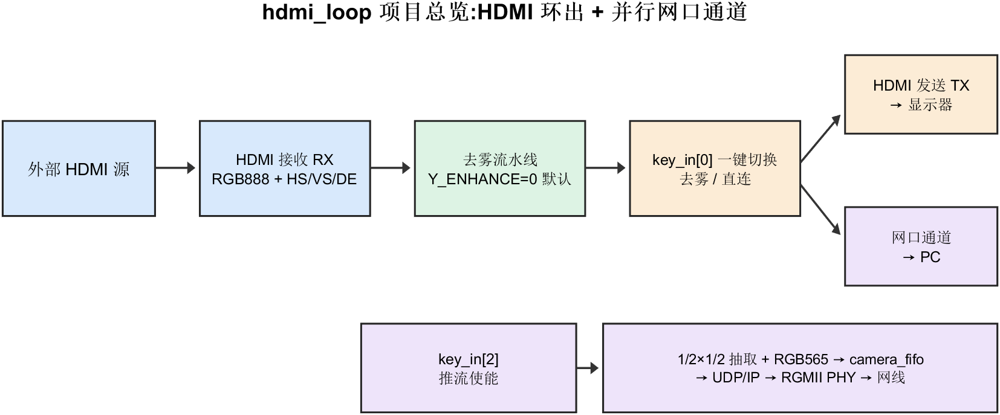
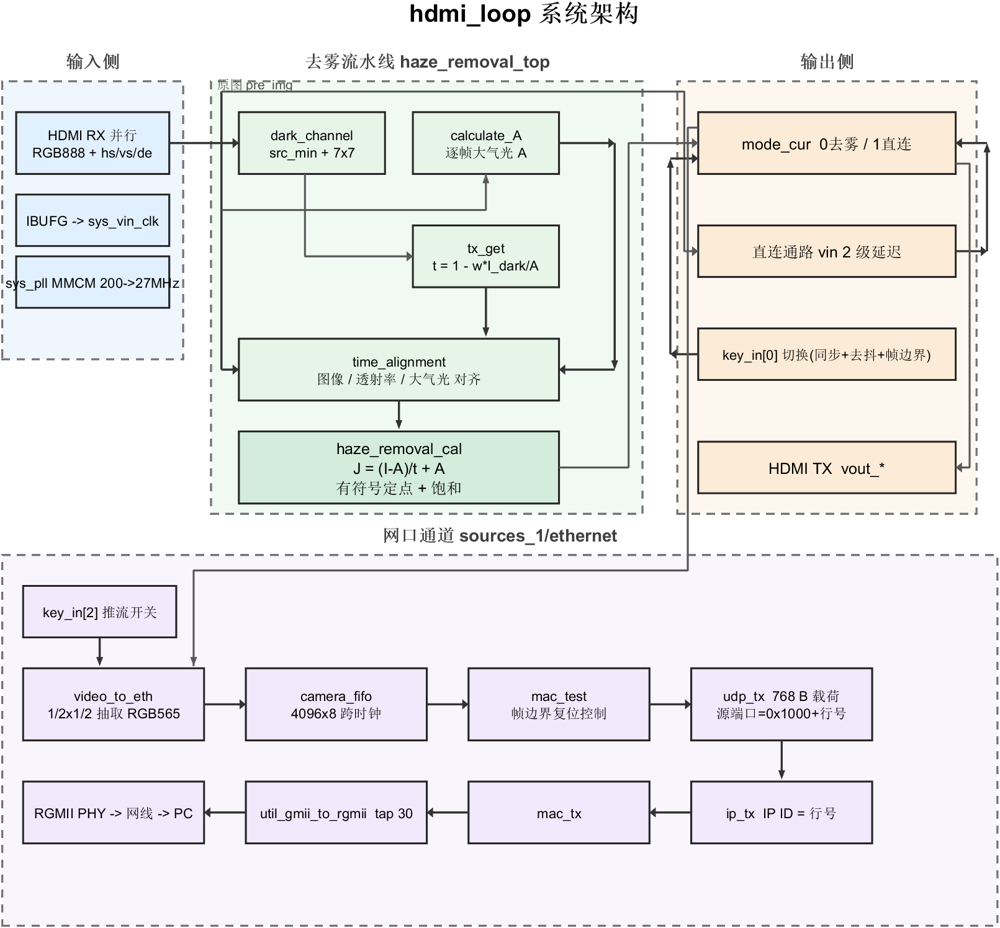
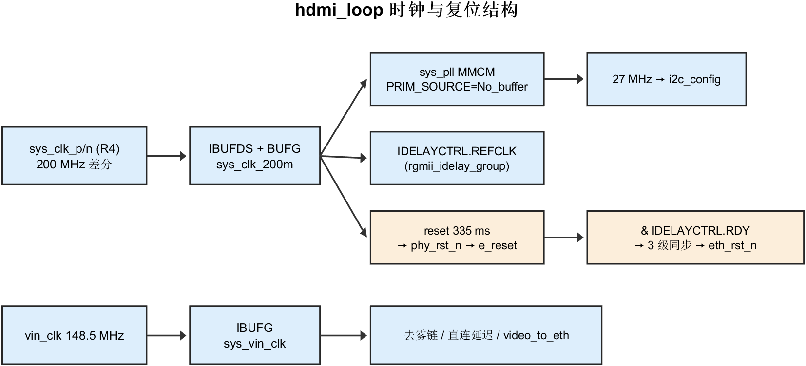
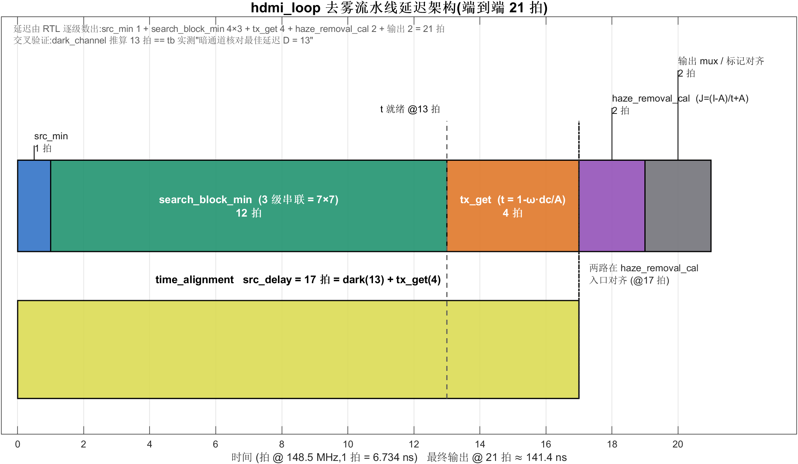
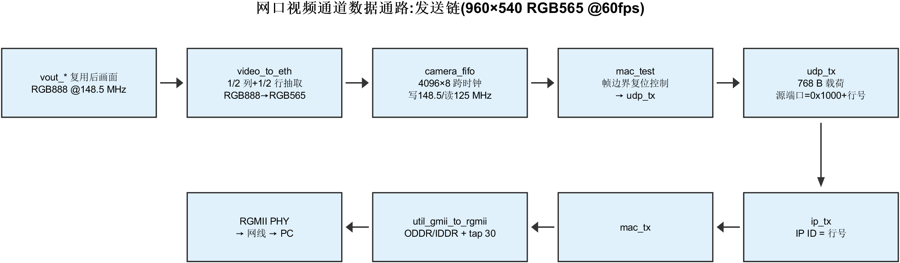
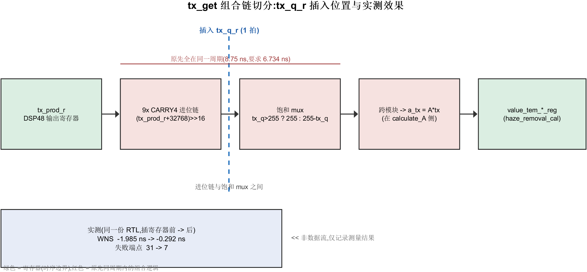

# hdmi_loop —— HDMI 实时暗通道去雾环出工程

## 一、项目简介

> **验证状态速览**(所有数字为离线复算,不依赖上板):
>
>
> | 验证项               | 命令                                               | 结果                                                                |
> | ---------------------- | ---------------------------------------------------- | --------------------------------------------------------------------- |
> | 去雾链 WP3(7×7)     | `xvlog`→`xelab`→`xsim`(tb 需排在 xvlog **最前**) | **PASS** · A=249 · 透射率 117..255 · 暗通道 7×7 核对 0/675 不符 |
> | 去雾链 WP1(3×3 A/B) | 同上,且 `xvlog` 加 `-d WP1`                        | **PASS** · A=249 · 透射率 55..255 · 暗通道 3×3 核对 0/1131 不符 |
> | `video_to_eth` 缩放  | `tools/tb_video_to_eth.v`                          | **PASS** · 写 48/48、每行 8/8、错位 0/48                           |
> | `udp_tx` 读使能      | `tools/tb_udp_tx_phase.v`                          | **PASS** · 3 包、读 3072/3072、错位 0/3072                         |
> | 上位机接收           | `python tools/tb_eth_recv.py`                      | **PASS** · **90 条断言**(合成报文 + 回环真实 UDP)                  |
> | 全量 elabor          | `xvlog` + `xelab`(含 unisims)                      | **0 ERROR**                                                         |
>
> **尚未验证**:比特流、上板联调(见第十一节)。⚠️ 时序**尚未达标但已大幅改善** —— `vin_clk` 域 **WNS −0.292 ns / 7 个失败端点**(原始 −25.527 ns / 72 个;插一级流水线后从 31 降到 7,数值逐位不变)。详见 §十一 第 2 步。
>
> ⚠️ 两个 tb 的 `RESULT: PASS|FAIL` 那行经 xsim 落进日志时会被 Windows 代码页吃掉;判据本身是多条件合取(见各 tb 末尾),上表数字即其各项。

本项目在 Xilinx **Artix-7 xc7a200tfbg484-2**(ALINX AX7A200,Vivado 2021.2)上实现一条 **HDMI 输入 → 暗通道先验去雾 → HDMI 输出** 的实时视频环路,并**并行**地把同一路去雾画面经千兆网口推给 PC:



> 项目总览:HDMI 环出 + 并行网口通道(蓝色=输入侧,绿色=去雾,橙色=输出,紫色=网口)

- 输入/输出均为 **RGB888 并行 + 行场同步/DE**,像素时钟约 **148.5 MHz**(1080p60),顶层把有效行宽配置为 **1920 像素/行**;
- 输入时钟 `vin_clk` 经 IBUFG 得到 `sys_vin_clk`,整条去雾链与输出同步于该时钟;
- 板载按键 **key_in[0]** 可随时在“去雾”与“直连(原图)”之间切换,便于 A/B 对比;
- 板载按键 **key_in[2]** 开关网口推流(默认开),网口输出 **960×540 RGB565 @60fps**(约 62 MB/s);
- 去雾算法基于 **暗通道先验 Dark Channel Prior**(何恺明等,CVPR 2009)。

## 二、功能特性


| 特性           | 说明                                                                |
| ---------------- | --------------------------------------------------------------------- |
| 实时去雾       | 全流水线,单个像素时钟处理 1 像素,不丢帧                             |
| 一键 A/B 对比  | key_in[0] 每按一次在 去雾/直连 间切换,默认去雾                      |
| 切换不撕裂     | 新模式只在帧边界(vsync 下降沿)生效                                  |
| 大气光逐帧更新 | A 按“最近一完整帧”统计并在帧边界锁存,场景变化可跟踪               |
| 定点实现       | 8 bit 像素,透射率/大气光 8 bit,内部有符号 18 bit 定点 + 0..255 饱和 |
| 可配置 Y 增强  | `Y_ENHANCE_ENABLE` 参数控制,YCbCr 亮度增强(默认关闭)                |
| 并行网口推流   | HDMI 环出不受影响;960×540 RGB565 @60fps,约 62 MB/s                 |
| 一键开关推流   | key_in[2] 开关(默认开),同样只在帧边界生效                           |
| 帧边界确定性   | FIFO 在每个 vsync 处“抽干→同步复位→释放”,每帧水平偏移恒为 0     |

## 三、算法原理

有雾成像模型:

```
I(x) = J(x)·t(x) + A·(1 − t(x))
```

- I(x):有雾观测图;J(x):待恢复清晰图;t(x):介质透射率;A:全局大气光。

去雾四步:

1. **暗通道** `I_dark(x)`:逐像素取 RGB 三通道最小值(`src_min`),再经 **7×7** 滑动窗口取最小值 —— 由 3 级 3×3 `search_block_min` 串联而成。盒式最小值(形态学腐蚀)可组合:`[-1,1]² ⊕ [-1,1]² ⊕ [-1,1]² = [-3,3]²`,所以三级串联**恰好**是一个 7×7 窗口,不需要新模块、也不用改行缓存;
2. **大气光 A** `calculate_A`:统计一帧内“像素三通道最大值”的全局最大,作为大气光(单标量近似);
3. **透射率 t** `tx_get`:`t = 1 − ω·I_dark/A`,ω=**0.85**(定点 218/256,参数 `MODIFICATION_VALUE`;He 原论文为 0.95 = 243/256,即"去雾更强、画面更暗"那一档);A 滞后当前帧约一帧;
4. **复原 J** `haze_removal_cal`:`J = (I − A)/max(t, t₀) + A`,t₀ = 26/256 透射率下限。

**定点实现与已修复的数值问题**

- `tx` 以 `tx/256` 表示,下限 `tx_min=26`(防止除零/过曝);
- 复原分子按有符号 18 bit 定点计算:`value_tem = (I−A)·256 + A·tx`。原代码用**无符号 8 bit 减法**求 `I−A`,凡 `I<A`(雾天绝大多数像素)都会回绕成大正数,约七成像素算错;现改为**有符号差分**后再取商;
- 除法结果必须 **0..255 饱和**(天空等亮区商可 >255,暗区可为负),原代码直接截断低 8 位,色彩错误;
- 大气光 A 现**逐帧重置累计**并加下界 1,避免跨帧漂移与全黑帧除零;透射率除法结果加 **0..255 钳位**,防止场景突变(dc>A)时无符号相减回绕。越界(商 >255,即 ω·I_dark/A > 1)时钳到 **255 = 不去雾**。旧代码钳到 `8'd0`,会被下游 `tx_min` 兜到 26,也就是**最强去雾** —— 恰好是注释里那句"完全不除雾"的反面;而这条路径是可达的(A 滞后一帧,复位后 `A_value_out` 还停在默认 230),场景一变亮就整片压黑。

## 四、系统架构



> 系统架构。虚线框为四个功能分区;实线箭头为视频数据流。

## 五、时钟与复位结构(顶层 hdmi_loop)



> 时钟与复位结构。200 MHz 差分经 IBUFDS+BUFG 后分三路;复位链刻意不从 gmii_rx_clk 派生,避免 PHY 复位期间无 RXC 而死锁。

- **200 MHz 差分** `sys_clk_p/n`(R4)现由顶层**显式** `IBUFDS + BUFG` 缓冲成 `sys_clk_200m`,同时供 `sys_pll`(MMCM,输出 27 MHz 给 I2C)和 `IDELAYCTRL`;
- **`sys_pll` 的 `PRIM_SOURCE` 必须改成 `No_buffer`**(见 [tools/setup_eth_ip.tcl](tools/setup_eth_ip.tcl))。原因:IDELAYCTRL 需要 200 MHz 参考,而板载唯一的 200 MHz 就是这对差分脚;一对时钟脚只能驱动**一个**输入缓冲,而 `sys_pll` 的生成 wrapper 内部已实例化了一个 IBUFDS,再挂一个会在 IO placer 阶段报 `[Place 30-602] IO port 'sys_clk_p' is driving multiple buffers`(无 XDC 属性可绕过)。改完后 `clk_in1` 变成普通输入,顶层把 BUFG 输出接进去。**改之前 `hdmi_loop.v` 无法 elaborate**(wrapper 仍暴露 `clk_in1_p/clk_in1_n`),所以必须先跑 Tcl 再综合;
- 也无法用 MMCM 再分频出 200 MHz 绕开:当前 VCO 742.5 MHz,742.5/200 不是整数;
- `locked` 作为全局复位 `rst_n`,并直接驱动三个 HDMI 芯片复位脚(`hdmi_nreset_v10 / hdmi_nreset / hdmi_in_nreset`);
- 输入视频时钟 `vin_clk`(约束 6.734 ns)经 `IBUFG` → `sys_vin_clk`;`vout_clk = sys_vin_clk`(输出跟随输入时钟,无需 TX 侧再锁相);
- `i2c_config_m0`(OpenCores I2C 主机,27 MHz 分频约 7 kHz SCL)上电初始化 HDMI RX/TX 芯片;
- **复位释放顺序**:`locked` → 335 ms 计数器(`reset.v`)→ `phy_rst_n` → `e_reset`;`eth_rst_n = phy_rst_n & locked & IDELAYCTRL.RDY` 经 `gmii_rx_clk` 域 3 级同步器释放。**刻意不从 `gmii_rx_clk` 派生复位再等 PHY**——PHY 复位期间可能不输出 RXC,会死锁。

## 六、按键模式切换逻辑

- 极性:**按下 = 低**(key_in[0] 引脚 L19);
- 2 级触发器把按键同步到 `sys_vin_clk`;
- ~14.8 ms 稳定计数去抖(`KEY_STABLE=2_200_000 @148.5MHz`);
- 检测到去抖后的“1→0”按下沿 → 翻转请求模式 `mode_next`;
- 在 **vsync 下降沿(帧边界)** 才把 `mode_next` 落到生效寄存器 `mode_cur`;
- 输出 mux:`vout_* = mode_cur ? 直连(vin_* 2 级延迟) : 去雾(haze_*)`。

默认 `mode_cur=0` = 去雾。

**key_in[2] = 网口推流开关**([hdmi_loop.v](hdmi_loop.srcs/sources_1/new/hdmi_loop.v),引脚 K17):

- 与 key_in[0] 完全同构:2 级同步 + 14.8 ms 去抖 + 按下沿翻转 `push_req` + **帧边界**落到 `push_en`;
- `push_en` 初值 **1(默认开)**——按键未按下时 `key_in[2]=1`,去抖后电平为高,推流开启;
- `push_en` **只门控 FIFO 写使能**,不门控 FIFO 复位、也不门控行/帧计数器。否则关断期间 FIFO 里会残留半个帧,重新打开后 `mac_test` 会从残帧中间开始发包;
- 关断期间 HDMI 输出**完全不受影响**,`video_to_eth` 的列/行/帧计数继续跑,所以重新打开一定落在行边界上。

`key_in[1]` / `key_in[3]` 预留(已在 XDC 定义引脚,逻辑未使用)。

## 七、流水线延迟架构

全链在 `sys_vin_clk`(148.5 MHz,6.734 ns/拍)单时钟域内,逐像素全流水,每拍处理 1 个像素。**一次去雾的总延迟 = 21 拍 ≈ 141 ns**,分四段:



> 横轴为**拍**(148.5 MHz,1 拍 = 6.734 ns),每个方块宽度 = 该模块的流水线级数。
> 上条是去雾数据通路(21 拍),下条是 `time_alignment` 对齐通路(17 拍);
> 两条竖线标出 `t` 就绪(@13 拍)与两路在 `haze_removal_cal` 入口对齐(@17 拍)。

### 逐级延迟表(全部由 RTL 数出,非估计)


| 模块                                    | 延迟                | 依据                                                                     |
| ----------------------------------------- | --------------------- | -------------------------------------------------------------------------- |
| `src_min`                               | **1**               | 一次寄存 `pixel_min_of_rgb`                                              |
| `search_block_min`(×`WINDOW_PASSES`=3) | **4 / 级**,共 12    | `matrix_generate_3x3` 控制 2 拍 + 矩阵输出 2 拍;`sort3` 是纯组合(不占拍) |
| `dark_channel`                          | **13**              | 1 + 4×3                                                                 |
| `tx_get`                                | **4**               | `modify_A`→`recip_r`→`tx_prod_r`→**`tx_q_r`**                         |
| `haze_removal_cal`                      | **2**               | `value_tem_*`→`prod_*`(DSP48);输出饱和寄存,与 `pre_tx_*_d3` 并行        |
| `time_alignment.src_delay`              | **17**              | 推导式 `1 + 4*WINDOW_PASSES + 4`                                         |
| **端到端**                              | **21 拍 ≈ 141 ns** | 13(暗通道) + 4(tx_get,含新加那拍) + 2(复原) + 2(输出 mux 等)             |

### 为什么 `src_delay` 是 17,而不是 13

`dark_channel` 输出 **t**(透射率)只比原图晚 **13** 拍,但 **t 要再穿过 `tx_get` 的 4 拍**才能到 `haze_removal_cal` 的输入。所以原图必须**多等 4 拍**,才能和 t 在 `haze_removal_cal` 入口相遇:

```
src_delay = dark_channel(13) + tx_get(4) = 17
```

这也是 `time_alignment.v` 里那句推导式 `1 + 4*WINDOW_PASSES + 4` 每一项的来源:**

- `1` = `src_min`
- `4*WINDOW_PASSES` = 每级盒式最小值 4 拍(2 拍控制 + 2 拍矩阵)
- `4` = `tx_get` 的流水线级数

⚠️ **改任何一项都必须同步改这个推导式**:改窗口级数要动 `WINDOW_PASSES` 两处(`dark_channel.v` 与 `time_alignment.v` 必须一致);在 `tx_get` 里加/减流水线寄存器要动那个 `+ 4`。漏改不会有综合错误,**只会在画面上表现为水平错位/拖影**,只有仿真能发现。

> 本次为时序在 `tx_get` 插入 `tx_q_r` 时,`+ 3` 就同步改成了 `+ 4`;`tb_haze_removal_top.v` 的两档 A/B 是验证这件事的手段 —— 校验和逐位不变、只有"最佳延迟 D"各 +1(19→20、23→24),即改动确实只是延迟、没有改变数值。

### 暗通道的"因果"窗口偏移

`search_block_min` 的 3×3 窗口是**因果锚定**的(锚在当前像素、向左上扩展),所以 `(x,y)` 处的暗通道实际是 `x-6..x, y-6..y` 上的最小值,而非居中的 7×7。这使透射率图相对原图偏 **3 行 + 3 像素**(居中窗口本可 0 偏移)。仿真里"暗通道核对最佳延迟 = 13"正是这个固有偏移与流水线延迟的合成结果,7×7 核对 0/675 不符说明 RTL 与"因果 7×7 盒式最小值"模型逐位一致 —— 偏移是**设计选择**,不是 bug。

### 三处时序瓶颈(历史与现状)


| 位置                                                                 | 状态                                                                      |
| ---------------------------------------------------------------------- | --------------------------------------------------------------------------- |
| `haze_removal_cal` 的 18÷8 组合除法                                 | **已消掉** —— 改 256 项倒数查表 + DSP48(−25.527 → −1.985 ns)         |
| `tx_get` 的 `tx_q` 组合链(9×CARRY4 + 饱和 mux,跨模块接 `a_tx=A*tx`) | **已切一刀** —— `tx_q_r` 寄存(−1.985 → −0.292 ns,31 → 7 个失败端点) |
| 剩余 7 个端点(`tx_q_r` → 钳位 → `a_tx` → `value_tem`)             | **未解决** —— 布线占 58%,时钟网络已吃 4.961 ns,只能再切一刀流水线       |

详见 §十二 第 2 步的实测数据。

## 八、网口视频通道(960×540 RGB565 @60fps)

### 7.1 数据通路



> 网口数据通路。载荷 768 字节能整除帧长(1,036,800 = 1350×768),抽干正好落在 0。

- **带宽**:540 行 × 1920 字节 × 60 fps = **62.2 MB/s**;千兆线速扣除 Eth/IP/UDP 头约 **112~118 MB/s**,余量充足。
- **载荷长度 768 字节不是随便取的**:一帧 1,036,800 = **1350 × 768 整除**。原因见 7.2——MAC 只在攒够一个完整载荷时才发包,帧末尾不足一包的字节永远发不出去,只能被 FIFO 复位丢掉。载荷能整除帧长时,抽干正好落在 0,**一帧一个字节都不丢**。1024 除不尽(余 512);512 能整除但要 2025 个包、约 12.1 万包/秒,对收包 socket 压力大。768 → 1350 包/帧、约 8.1 万包/秒、链路效率 93%。
- **垂直抽取是承重设计**:若去掉行抽取,速率翻倍到 128 MB/s **超过线速**,4096 深的 FIFO 约 13 行就会写满。`video_to_eth.v` 顶部注释里写明了这条约束。
- **抽取起点由 `de` 间隙推导**,不依赖 `vin_hs`/`vin_vs` 的极性:行消隐 280 拍、场消隐约 99000 拍,`de` 连续为低 ≥1000 拍即判为场消隐。`de` 每个有效像素恰好一个脉冲,所以每行写脉冲数天然等于 1920,可用 ILA 直接核对。
- **只跨电平,不跨单拍脉冲**:6.734 ns 的单拍脉冲短于一个 125 MHz 周期,会被漏采。`eth_href`/`eth_vsync` 都是电平,进 `gmii_rx_clk` 域先过 2 级同步器。

### 7.2 帧边界确定性(参考工程最大缺陷,已重写)

参考工程(26_video_ethernet)用 `cmos_vsync` **异步复位 FIFO**,后果有两个:残余的不足一包的字节被静默丢弃,每帧水平偏移随机;若复位时 MAC 正在发包,读指针跳回 0 会让包中间混入垃圾字节。

本工程改为四态控制器(`eth_video_tx.v` 的 `F_IDLE→F_DRAIN→F_RESET→F_WAIT`):

1. 同步后的 vsync 上升沿 → 停写(`video_to_eth.wr_ready` 拉低);
2. **抽干**:等 `fifo_rdusedw < UDP_SEND_LEN` **且** `mac_sending == 0`(MAC 不在包中间);
3. 发 16 拍复位脉冲;
4. 等 `wr_rst_busy` / `rd_rst_busy` 都落下,才回到 IDLE 释放写使能。

第 2 步的条件**不是** `fifo_rdusedw == 0`,虽然那才是直觉写法。`mac_test` 只在攒够**一整包**时才起包,所以它停下来时 FIFO 里恒有 0~(UDP_SEND_LEN−1) 字节残料,计数永远回不到 0;写侧就永远等不到释放,整机变成"发完一帧就冻住"。判据写成"**残料已不足以再发一包**"既等价于"MAC 发不出下一个包",又一定终止(计数每包正好减 UDP_SEND_LEN)。

场消隐有 666 µs,FIFO 最多 4 KB,抽干远快于此。于是"**复位后第一个字节 = 帧的第一个字节**"由构造保证。

### 7.3 一并修掉的参考工程缺陷


| 位置                         | 问题                                                                                                                                     | 修法                                                                                             |
| ------------------------------ | ------------------------------------------------------------------------------------------------------------------------------------------ | -------------------------------------------------------------------------------------------------- |
| `mac_test.v`                 | FIFO 阈值`>1000` **小于 1024 字节包长**,恰好 1001 时 `udp_tx` 越界读、包尾是垃圾                                                         | 改成由载荷长度派生:`fifo_rdusedw >= udp_send_data_length`,阈值再也不会和包长脱节                 |
| `mac_test.v`                 | `fifo_data_count` 声明 `[10:0]`,而 IP 的 `rd_data_count` 是 12 bit,高位被丢 → 计数 mod 2048 回绕后 MAC 停读、卡满 1 s 超时              | 全部加宽到`[11:0]`                                                                               |
| `udp_tx.v`                   | `udp_send_cnt < total_data_length - 3` 会发出 **载荷+1 次读使能**(1024 字节包下即 1025 次),每包多读 1 字节 → 每帧累计流错位约 1012 字节 | 改`- 4`;并用 3 包仿真证明:改前 3075 次读 / 3072 字节载荷里 2048 处错位,改后 3072 次读 / 0 处错位 |
| `util_gmii_to_rgmii` wrapper | IDELAYCTRL 的`RDY` 悬空、`RST` 接 0;若 200 MHz 未稳则 IDELAY 抽头未校准,RGMII 收不到包,ARP 永远失败且无任何可见原因                      | `RST` 接 `~locked`,**`RDY` 参与 `eth_rst_n` 释放条件**                                           |
| FIFO`.full()` 悬空           | 无任何背压/丢弃统计                                                                                                                      | 接出到`fifo_full_dbg`                                                                            |

### 7.4 上位机

参考工程 `video.exe`(位于 `26_video_ethernet/`,**该目录当前不在此仓库内**)写死 800×600,不兼容本工程的 960×540,因此自研 [tools/eth_recv.py](tools/eth_recv.py):

- UDP 目的端口 **8080**、源端口 **`0x1000 | (行号 & 0x3FF)`**,**载荷 768 字节**。行号实际是 **1~540**(注意**从 1 开始**,见下),所以线上看到的源端口是 **4097~4636**;掩码的作用是让源端口**永远不会跑出 `0x1000~0x13FF`**,于是"这是不是源端口版 bitstream"这个判断无法被误判。4640~5119 的源端口会被接收端**拒绝**——那只能是计数器跑飞后被掩码绕回来的结果,不是某一行;
- **行号是 1 基的,不是 0 基**。`identify_code` 在 vsync 沿清零,之后每来一个保留行的 href 下降沿 +1,于是 540 行拿到的是 **1~540**,**0 从未发过**。实机 32 万个包实测:源端口只出现 4097~4636,4096 一次都没有。这一点必须记住,否则接"合法行号是 0~539"去写接收端,就会把每一帧**末尾标号 540 的那 3 个包**(每帧 1350 个包,末标号占 3 个)当成非法丢掉,帧永远少 2304 字节、永远合不成——这正是本工程踩过的一个坑;
- 帧内的**标号是每包一个还是每行一个**也要注意:一行 1920 字节、一包 768 字节,**一行 = 2.5 个包**,所以标号在相邻包之间会**重复**(奇偶行分别是 3 个、2 个包),**只有"标号回退"才是帧边界**,数标号变化次数是错的;
- 一帧 1,036,800 字节 = **恰好 1350 个包**,帧正好落在包边界上(见 7.1 的载荷选择);
- 行号(`identify_code`:vsync 清零、每个保留行 +1,故为 **1~540**)**同时出现在两个地方**——IP 头的 Identification 字段,以及 UDP 源端口。帧内行号单调不减,**行号回退即帧边界**。用行号而不是数包,是为了丢包后能立刻重新对齐——数到 1350 一旦中途丢一个包就永久错位;
- 注意**一行跨 2.5 个包**(1920 ÷ 768),行号不是一包一变,而是连续若干包相同;只有**回退**才是帧边界;
- 两种读法对应 `--framing raw` 与 `--framing port`,默认 `auto` 自动探测;`auto` **不会静默降级**:需要 raw 而 raw 建不起来时直接报错退出;
- 源端口窗口 4097~4636 里,**4500 对应行号 404**,而 4500 是 Windows 的保留端口(IANA 分配给 IPsec NAT-T),本机**无法 bind**。这不影响本工程——发包方是 FPGA,PC 只 bind 8080,接收套接字接受任意源端口;但如果要在 PC 上模拟板子发包,需要避让这一条(自检脚本因此改用 `0x2000` 起始的窗口);
- 合成帧长度不等于 1,036,800 一律判丢包并丢弃(短帧解出来是明显的错行,会掩盖真正的问题);
- **逐项统计被拒原因**(长度不足 / 非 IPv4 / IHL 非法 / 协议非 UDP / 源 IP / 目的 IP / 目的端口 / UDP 长度 / 载荷长度 / 源端口落在窗口内但行号 > 540 / `MAX_CUR` 内始终未见帧边界),接受率低于 50% 时打印明细并直接点出诊断;
- `--snapshot FILE`:存下第一帧完整画面(`.bin`/`.raw` 后缀存原始 RGB565,其余交 `cv2.imwrite`);`--duration SECS`:跑满指定秒数后自动退出,便于无人值守抓取;
- RGB565 → BGR 后 `cv2.imshow`,同时打印 fps / MB/s / 当前行号。

```bash
pip install numpy opencv-python
python tools/eth_recv.py                 # 实时显示(auto 探测定界方式)
python tools/eth_recv.py --framing port  # 指定用源端口读行号
python tools/eth_recv.py --framing raw   # 指定用 IP 头读行号(需管理员)
python tools/eth_recv.py --no-display    # 只统计,便于长时间跑
python tools/eth_recv.py --save out.avi  # 同时录制
```

**为什么原来必须用原始套接字,以及为什么最终改成源端口。** 行号最初只放在 IP 头里,
而 Linux/Windows 的 `recvfrom` 在普通 UDP 套接字上**只交付 UDP 载荷**,IP/UDP 头由内核剥掉;
要看见 IP 头必须开 `SOCK_RAW`。参考工程 `video.exe` 正是如此——它导入 `pcap_open_live` /
`pcap_next_ex` / `wpcap.dll`,是 **WinPcap 抓包**,不是 UDP 套接字。

代价是:Windows 创建 `SOCK_RAW` **必须管理员权限**;`bind` 只能绑具体本机 IP(`0.0.0.0` 报
`WSAEINVAL`);防火墙按应用放行,raw 套接字的 bind 不会自动建立入站放行规则,所以脚本额外绑了一个
**不读的普通 UDP 套接字**同时兼作"让 WFP 规则成立"和"避免内核回灌 8.1 万个 ICMP 端口不可达"。

把行号挪进**源端口**后,普通 UDP 套接字即可——`recvfrom` 返回的 `addr[1]` 就是行号,
不需要管理员、不需要解析包头(在 8.1 万包/秒下也便宜得多)、还免掉了防火墙这一环。
源端口不参与 IP 校验和的计算,所以改动对线上其余部分零影响。IP ID 里的行号**保留不动**,
两种读法因此可以互相校验。

#### 离线自检

```bash
python tools/tb_eth_recv.py   # 不插板子、不需要网卡、不需要管理员
```

共 **90 条**断言。用合成报文把两种定界各跑一遍,断言两边解析出的行号、载荷、帧边界完全一致、
**重组出的帧逐字节等于源数据**;断言丢一个包时该帧被判"短"并**不显示**、下一帧立刻恢复;
断言"**解析逻辑与套接字类型不匹配**"会被明确拒绝,而不是以 0.2% 的比例偷偷接受;
最后一项走**真实 UDP 套接字**(回环、1351 个包),端到端验证"源端口 → 行号 → 重组"这条链。

原始版本正是栽在后者:普通 UDP 套接字却按"缓冲区开头是 IP 头"解析,于是把两个像素字节当行号,
判掉 99.8% 的包却一路正常打印统计行——看起来像硬件故障,实际上是接收端自己的 bug。
这类"怎么开套接字"和"怎么解析字节"不匹配的错误,正是这个自检能提前抓住的。

> **接收端缓冲区**:约 8.1 万包/秒、62 MB/s 的小包流会瞬间打满默认 64 KB 的 socket 接收缓冲,内核静默丢包。脚本已把 `SO_RCVBUF` 顶到系统上限并打印实际拿到多少;仍见丢包时按脚本头部注释调大系统上限。

#### 工程文件索引


| 文件                                   | 作用                                                                                                        |
| ---------------------------------------- | ------------------------------------------------------------------------------------------------------------- |
| `hdmi_loop.xpr`                        | Vivado 2021.2 工程,可直接打开                                                                               |
| `hdmi_loop.xdc`                        | 全部引脚/时钟约束                                                                                           |
| `hdmi_loop_gen.tcl`                    | **工程生成脚本**:从零重建本工程(见下方"重建工程")                                                           |
| `tools/setup_eth_ip.tcl`               | **一次性工程改造**:加以太网源文件、改 `PRIM_SOURCE`、建 `camera_fifo`。新克隆的工程必须先跑它才能 elaborate |
| `tools/eth_recv.py` / `tb_eth_recv.py` | PC 端接收程序 / 其离线自检                                                                                  |
| `tools/tb_haze_removal_top.v`          | 去雾链离线自校验 tb(`-d WP1` 可切 3×3 窗口做 A/B)                                                          |

#### 重建工程(从零复现)

```bash
# 在任意空目录执行;--origin_dir 指向本仓库
vivado -mode batch -source <仓库>/hdmi_loop_gen.tcl \
       -tclargs --origin_dir <仓库>
```

脚本用 `-no_copy_sources` 生成,即**引用**而非拷贝源文件。两点须知:

- **脚本不自动跑综合**,只重建工程、fileset 与 run 配置;
- 生成后若报 `utils_1 ... does not exist` 之类,是因为增量综合参考点 `.dcp` 不在库内。`hdmi_loop_gen.tcl` 已对这种情况加了守卫:文件在则启用增量综合,不在则**静默退回全量综合**(正确性不受影响,只是慢一些)。
- **本脚本是手工维护版**:它在 `write_project_tcl` 的原始输出之上加了三处守卫注释。若日后重新生成覆盖了它,需要重新打这三处补丁。

### 7.5 上电与联调顺序

1. **PC 必须先配成 `192.168.0.3`**(或按需修改 `mac_test.v` 里的目的 IP)。固件侧目的 IP `192.168.0.3`、源 IP `192.168.0.2`、源 MAC `00:0a:35:01:fe:c0`、UDP 8080 全部写死,且 `arp_cache` **无老化**,配错只会每秒重发 ARP,永远不出图,且**只能复位 FPGA 恢复**。
2. 上板看:`locked` → `IDELAYCTRL.RDY` → PHY 链路灯 → ARP 成功(`u_mac_test/mac_not_exist` 拉低,建议挂 ILA)→ Wireshark 可见 8080 包 → `eth_recv.py` 出图。
3. **Wireshark 先确认线上是什么**(两分钟、零改动):过滤 `udp.port == 8080 && ip.src == 192.168.0.2`,期望包长 768 字节、约 81000 包/秒。再看行号在哪:新版 bitstream 的 `udp.srcport` 应在 4097~4636 之间随行号变化;若 `udp.srcport` 恒为 8080,则是改动前的 bitstream,用 `--framing raw`(管理员)。`ip.id` 在新旧版都应是 **1~540** 的单调爬升(1 基,见 7.4)。
4. ARP 一直失败时,优先查固定 `IDELAY_VALUE(30)` 是否匹配本板 RX 偏斜,以及 PC 的 IP。
5. 按 `key_in[2]`,确认关断期间不再发包、重新打开后画面完整无偏移。

**MDIO 全程不工作**(`e_mdc` 拉低、`e_mdio` 高阻),依赖 PHY 上电默认千兆全双工。

## 九、模块清单


| 模块                                   | 位置                      | 功能                                                                                                             |
| ---------------------------------------- | --------------------------- | ------------------------------------------------------------------------------------------------------------------ |
| `hdmi_loop`                            | sources_1/new             | 顶层:时钟/复位/I2C/按键切换/输出去雾或直连/网口推流                                                              |
| `haze_removal_top`                     | sources_1/darkchannel     | 去雾链顶层,generate 选择默认去雾或 Y 增强                                                                        |
| `dark_channel`                         | sources_1/darkchannel     | 暗通道顶层(src_min + search_block_min)                                                                           |
| `src_min`                              | 同左                      | 逐像素 RGB 三通道最小值                                                                                          |
| `search_block_min`                     | 同左                      | 3×3 窗口最小值(4× sort3);被`dark_channel` **串联 `WINDOW_PASSES`(=3)次**,整体等价 7×7 窗口                    |
| `matrix_generate_3x3`                  | 同左                      | 3×3 滑动窗口寄存器组                                                                                            |
| `one_column_ram` / `fifo_ram`          | 同左                      | 两条 1920×8 行缓冲(推断为 2 个 Block RAM)                                                                       |
| `sort3`                                | 同左                      | 3 个数排序(最大/中值/最小)                                                                                       |
| `calculate_A`                          | 同左                      | 大气光 A:逐帧最大值,帧边界锁存 + 下界 1                                                                          |
| `tx_get`                               | 同左                      | 透射率 t = 255 − ω·256·I_dark/A(ω=0.85 → 218),商 0..255 钳位(越界钳 255 = 不去雾);**除法已改为倒数查表乘** |
| `time_alignment`                       | 同左                      | 对齐原始图像与 t/A(src 延迟由窗口级数推导:`1 + 4*WINDOW_PASSES + 3`,WP=3 时为 **16** 拍)                         |
| `haze_removal_cal`                     | 同左                      | 复原 J:有符号 18 bit 定点 + 0..255 饱和(默认非 IP 分支);**除法已改为倒数查表乘**                                 |
| `VIP_RGB888_YCbCr444` / `YCbCr2RGB`    | 同左                      | Y 增强休眠分支(Y_ENHANCE=1)用,默认不综合                                                                         |
| `sys_pll`                              | sources_1/ip              | MMCM 时钟 IP(`PRIM_SOURCE=No_buffer`)                                                                            |
| `i2c_config` 等                        | sources_1/new             | OpenCores I2C 配置链                                                                                             |
| `hdmi_loop.xdc`                        | constrs_1/new             | 管脚约束 + 时钟约束 + RGMII 段 + 时钟组                                                                          |
| `video_to_eth`                         | sources_1/ethernet        | **新增**:1/2×1/2 抽取、RGB888→RGB565、字节发射、行/帧计数                                                      |
| `eth_video_tx`                         | sources_1/ethernet        | **新增**:IDELAYCTRL + FIFO + MAC + RGMII + 帧边界复位控制器                                                      |
| `camera_fifo`                          | sources_1/ip              | **新增**:4096×8 独立时钟 FIFO(由 Tcl 生成)                                                                      |
| `mac_test` / `mac_top`                 | sources_1/ethernet/mac    | UDP/ARP/IP 收发状态机(**已修 3 处缺陷**)                                                                         |
| `udp_tx` / `ip_tx` / `mac_tx` 等       | sources_1/ethernet/mac/tx | 发送链;**`udp_tx` 已修 off-by-one**                                                                              |
| `util_gmii_to_rgmii`                   | sources_1/ethernet        | RGMII↔GMII(ODDR/IDDR + IDELAYE2,固定 tap 30)                                                                    |
| `reset`                                | sources_1/ethernet        | 335 ms 上电复位计数器                                                                                            |
| `tools/setup_eth_ip.tcl`               | tools                     | **一次性工程改造脚本**(加源文件 / 改 PRIM_SOURCE / 建 FIFO)                                                      |
| `tools/eth_recv.py`                    | tools                     | **PC 端接收程序**(UDP 8080 → 960×540 显示,**双定界:raw / port**)                                               |
| `tools/tb_eth_recv.py`                 | tools                     | `eth_recv` 离线自检(**90 条断言**,合成报文跑两种定界,不插板子)                                                   |
| ~~`captures/frame.bin` / `frame.png`~~ | ~~captures~~              | **已缺失(不在磁盘、也不在 git 历史)** —— 实机抓取的一帧原始 RGB565 与对应的可视 PNG                            |
| ~~`captures/ten_seconds.avi`~~         | ~~captures~~              | **已缺失(不在磁盘、也不在 git 历史)** —— 实机抓取的 10 秒视频(960×540 @60fps)                                 |
| `tools/tb_video_to_eth.v`              | tools                     | `video_to_eth` 自检 testbench(缩放时序,已 PASS)                                                                  |
| `tools/tb_udp_tx_phase.v`              | tools                     | `udp_tx` 读使能数自检 testbench(3 包,已 PASS)                                                                    |

## 十、修复记录

1. **顶层多驱动清理**:删除残留的 `vin_*_d0/d1/d2` 直通与重复 `assign vout_clk`,`vout_*` 改由去雾模块唯一驱动(否则综合会把去雾当冗余剪掉或报多驱动)。
2. **复原算法修正**(haze_removal_cal):无符号回绕 → 有符号差分;结果加 0..255 饱和;累加器加宽到 18 bit。
3. **大气光逐帧重置**(calculate_A):A 不再向全局历史最大漂移;加下界 1 防除零。
4. **透射率稳健化**(tx_get):显式 16 bit 乘 ω·256;除法商 0..255 钳位防场景突变回绕,越界钳到 255(不去雾)。
5. **按键去雾/直连切换**(hdmi_loop):见第六节。
6. **组合除法 → 倒数查表乘**,以及随后的**一级流水线**(为时序):两处组合除法改为 **256 项倒数查表 + 乘法**,不引入新 IP、延迟确定 —— `haze_removal_cal` 的 `q = value_tem_r / $signed({10'b0, tx_value_d1})` 改为 `q = (value_tem_r * recip[tx_value_d1]) >>> 16`;`tx_get` 的 `tx_q = modify_A / A_value_d1` 改为 `tx_q = (tx_prod_r + 28'd32768) >> 16`。`recip[v] = round(65536/v)` 即 `(65536+(v>>1))/v`,除数范围 26..255,`recip[v<26]` 镜像 `v=26`。这是**功能性 bug 而非"slack 不好看"** —— `value_tem_*` 的商本身就算错。**时序尚未达标**,实测数字与后续方向见 §十一 第 2 步。
7. **网口视频通道**:见第七节,含参考工程 5 处缺陷修复。
8. **帧边界控制器死锁 + 载荷长度改为 768**(自审发现):
   - `F_DRAIN` 原写 `fifo_rdusedw == 0 && !mac_sending`。但 `mac_test` 只在攒够一整包时才起包,停下时 FIFO 恒有 0~767 字节残料,计数永远回不到 0 → 写侧永不释放,**发完一帧就冻住**。改为 `fifo_rdusedw < UDP_SEND_LEN && !mac_sending`;
   - 载荷 1024 → **768**:一帧 1,036,800 字节,**1024 除不尽(余 512)**,帧尾余数永远攒不成一包、只能被 FIFO 复位丢掉;768 整除(1350 包),抽干正好落在 0,一帧不丢一个字节。同时把 `mac_test` 的 FIFO 阈值由魔数改成从载荷长度派生 `>= udp_send_data_length`,从根上消除"阈值 < 包长"这类缺陷。
9. **上位机一帧都合不出来:套接字类型与解析逻辑不匹配**(见 7.4):
   - 现象:`dropped` 每 2 个包涨 1、`0.00 MB/s`、0 fps、"行号"在 12000~19000 之间乱跳,但脚本一路正常打印统计行;
   - 根因:`eth_recv.py` 开的是**普通 UDP 套接字**,却按"缓冲区开头就是 IP 头"解析。`recvfrom` 在 `SOCK_DGRAM` 上只交付 UDP 载荷,于是 `buf[0] >> 4` 是像素、`buf[4..5]` 是像素——两个像素字节被当成"行号"。仍有约 0.2% 的包靠巧合通过校验(6% × 1%),所以脚本看起来"在工作"。参考工程 `video.exe` 是 WinPcap 抓包,能看见 IP 头,该约定本来是给它用的;
   - 修法:`mac_test.v` 把行号同时写进 **UDP 源端口**(`0x1000 + 行号`,目的端口仍是 8080),接收端用 `recvfrom` 返回的 `addr[1]` 直接读行号,无需管理员、无需解析包头;IP ID 里的行号**保留不动**,`--framing raw` 仍可用,两种读法互为交叉校验;
   - 同时给接收端补上:**分步拒绝计数 + 低接受率告警**(不再"高高兴兴地拒掉 99.8%")、**源 IP / 目的 IP / 目的端口 / IP 协议校验**(raw 套接字会收到该 IP 上所有 IPv4 报文,Windows 下 `IPPROTO_UDP` 并**不**过滤)、**`MAX_CUR` 上限**(行号若恒不回退,原逻辑会以 62 MB/s 撑爆内存)、**帧号在 UDP 头里的稳定性**(`identify_code_d0` 只在 `CHECK_FIFO` 锁存,整包期间恒定);
   - 新增 `tools/tb_eth_recv.py`:不插板子即可跑,断言两种定界解析一致、且上述不匹配会被**明确拒绝**。本次自检本身就抓出了两个真实问题(raw 路径漏查 IP 协议字段;以及帧内行号"一行跨 2.5 包"的模型)。
10. **行号是 1 基的,接收端按 0 基设卡导致再次一帧不合**(实机联调):

- 现象:接受率 **99.8%**、62 MB/s、8.1 万包/秒,但 **10 秒 0 帧**,每帧恒短 **2304 字节(= 3 个包)**,且帧边界总是报在 "line 1";
- 根因:上一轮为防止"计数器跑飞被掩码绕回"加了一道 `line >= 540 即拒绝` 的卡。但实机 `identify_code` 是 **1 基**的(vsync 清零后第一个 href 下降沿就 +1),540 行拿到的是 **1~540**,**0 从未出现**。于是每帧末尾标号 540 的那 3 个包被当成非法丢掉,帧只剩 1347 个包 = 1,034,496 字节,与实测数字逐字节吻合;下一帧的首包标号 1 < 539,边界就报在 "line 1";
- **诊断手段**:直接对源端口做直方图(4 秒 32 万包),发现**只出现 4097~4636、4096 一次都没有**、4636 却是常客——一行数据就定位了。比对着日志猜快得多;
- 修法:卡改成 `line > 540`(接受 0~540 全区间,行号只作**排序提示**、不作行索引),自检的合成模型同步改成 1 基(`packet_line(i) = 2i//5 + 1`)并新增两条断言:标号 540 **必须被接受**、标号 0 也容许;
- 教训:**"合法值域"要从硬件实测反推,不能从文档假设**;而自检模型一旦和硬件不一致,它就会一路绿灯地把你送进坑里。
- 实机验证:修复后 10 秒收到 **595 帧、59.5 fps、100% 接受、62 MB/s**,`captures/frame.png` 颜色正常、无错行。

以上改动均通过 `xvlog` 语法检查 + `xelab` 全量 elabor(0 ERROR);综合/实现由开发者在 Vivado GUI 执行。

## 十一、已知限制与注意事项

- **`sys_pll` 必须先生成**:顶层改成 `.clk_in1(sys_clk_200m)` 后,若没先跑 [tools/setup_eth_ip.tcl](tools/setup_eth_ip.tcl) 把 `PRIM_SOURCE` 改成 `No_buffer` 并重新生成 IP,**elaborate 会直接失败**(wrapper 仍暴露 `clk_in1_p/clk_in1_n`)。这是本工程的第一个强制步骤。
- **垂直抽取不可去掉**:去掉行抽取会让网口速率翻倍到 128 MB/s,超过千兆线速,FIFO 约 13 行就写满。详见 7.1。
- **PC 必须处于 192.168.0.3 网段**:无 MDIO、无 ARP 老化,配错只能复位 FPGA 恢复。
- **固定 IDELAY tap 30 不自校准**:若本板 RX 偏斜不匹配,ARP 会一直失败。这是上板联调第一个要查的点。
- **RGMII 的 IO 延迟是估值**:XDC 里 `set_input_delay` / `set_output_delay` 的数值建模的是板级/PHY 偏斜,**不是硅片要求**,故意取宽。有 PHY datasheet 的真实 setup/hold 再替换,不要为了"时序过"去收紧。
- **休眠分支未启用且未维护**:`Y_ENHANCE_ENABLE=1`(Y 增强,含 Cb/Cr 交换、`+50` 无钳位、输出位序等已知缺陷)与 `Xilinx_IP` 分支(引用未建入工程的 div_gen IP)默认不参与综合,启用前需先修复。
- **块最小窗口是“因果”锚定,不是居中**:暗通道窗口锚在当前像素、向 `(x−K+1..x, y−K+1..y)` 扩展,透射率图相对原图约有 **3 行 + 3 像素**的固有偏移(3×3 时代是 1 行 + 1~2 像素,三级串联后按比例放大)。在雾梯度上这会系统性地“往亮处取样”,抬高 `I_dark`、压低 `t`,**部分抵消**加宽窗口的收益 —— 实测该帧 7×7 在这个锚定下的对比度增益约 1.51×,居中窗口本可到 2.02×。要消掉需给 src 通路补 3 行 + 3 像素的居中延迟(见 `dark_channel.v` 注释)。行缓冲不跨帧复位,每帧顶部约 7 行/左侧边缘像素的暗通道会混入相邻行。
- **窗口 7×7 与 ω=0.85 的实测依据**(源图从一张分析时的单帧抓图反解得到 —— 该文件 `tools/out.avi_20260921_212043.311.jpg` **现已不在磁盘、也不在 git 历史**,下方数字是当时实测的留档;帧本身可从 `tools/out.avi` 第 693 帧复现,该 avi 仍在。**建议据此补存一张抓图**,否则这条结论无法再被复算。该帧是真·浓雾:源图亮度均值 144、`I_dark/A ≈ 0.64`,连 15×15 窗口也只比 3×3 多找到 4.7% 的暗参考):3×3 ω=.95 输出亮度 48、偏色 R−B +15.6;7×7 ω=.85 输出亮度 81、R−B +11.9。窗口继续加宽到 9×9/15×15 已无收益(对比度增益在 9×9 饱和,15×15 反而略降),故取 7×7。仿真侧(`tools/tb_haze_removal_top.v` 的 `-d WP1` A/B)实测透射率下限从 **55/256(3×3)升到 117/256(7×7)**:3×3 会给大片“几乎全是大气光”的像素分配 `t≈0.21`(约 4.7 倍增益)从而压黑。窗口继续加宽到 9×9/15×15 已无收益(对比度增益在 9×9 饱和,15×15 反而略降),故取 7×7。仿真侧(`tools/tb_haze_removal_top.v` 的 `-d WP1` A/B)实测透射率下限从 **55/256(3×3)升到 117/256(7×7)**:3×3 会给大片“几乎全是大气光”的像素分配 `t≈0.21`(约 4.7 倍增益)从而压黑。
- **偏色不来自 RTL**:去雾对三通道是同参数的仿射变换(同一个 A、同一个 t),不可能制造偏色;它把源图自身的色偏按 `1/t` 放大。实测该帧源图本身近乎中性(R−B 仅 +5.2),输出 R−B +15.6 ≈ 3 倍,与 `1/t` 增益一致。要压偏色只能降 ω 或另加白平衡级。
- **大气光为单标量近似**:取全帧通道最大值(而非 He 原论文 top-0.1% 亮像素),对含大面积白物体的场景估计会偏亮,属可接受的硬件简化。
- **按键在 sys_vin_clk 域工作**:无 HDMI 输入时钟时按键无效(此时亦无画面,网口也一样)。

## 十二、验证流程(开发者在 Vivado GUI 执行)

> **本节是给"重新走一遍流程"的人看的。** 本仓库的 `hdmi_loop.xpr` **已经完成第 0 步**,直接打开就能综合。
>
> 唯一的例外是**从 `hdmi_loop_gen.tcl` 重建出来的工程** —— 那必须先跑第 0 步。

### 第 0 步:一次性工程改造(**当前仓库已做,新克隆/重建的工程才需要**)

```tcl
# 打开 hdmi_loop.xpr,在 Tcl 控制台执行:
source tools/setup_eth_ip.tcl
```

它会:把 `sources_1/ethernet/` 下 22 个 .v 加入工程 → 把 `sys_pll` 改成 `PRIM_SOURCE=No_buffer` 并重新生成 → 新建 `camera_fifo`。**不要把 26_video_ethernet 的 `.xci` 拷过来**——那是 2023.1.1 写的、`gen_directory` 指向不存在的路径,打开会触发 IP 升级,可能改掉 `wr_rst_busy/rd_rst_busy` 复位结构。

**怎么判断它已经做过了**(三项都已生效就别再跑):


| 判据                                                             | 已做                           | 未做                             |
| ------------------------------------------------------------------ | -------------------------------- | ---------------------------------- |
| `hdmi_loop.gen/sources_1/ip/sys_pll/sys_pll.v` 有无内部 `IBUFDS` | **无** → `clk_in1` 是普通输入 | 有 → wrapper 暴露 `clk_in1_p/n` |
| `hdmi_loop.srcs/sources_1/ethernet/` 的 .v 在工程里              | 22 个                          | 0 个                             |
| `camera_fifo` 是否在工程中                                       | 在                             | 不在                             |

判据不对就重跑 `source tools/setup_eth_ip.tcl`。

### 第 1 步:综合

Run Synthesis → 期望 **0 ERROR、无 multiple driver**;Utilization 里 **Block RAM > 0**(两条 1920×8 行缓冲 + camera_fifo),**DSP48 > 0**(倒数查表乘)。

### 第 2 步:实现

Run Implementation → **先按名字审失败端点列表,不要只看 WNS 数字**。

⚠️ **`vin_clk` 域仍未达标,但已从 31 个失败端点降到 7 个。** 实测(`hdmi_loop.runs/impl_1/hdmi_loop_timing_summary_routed.rpt`):


|               | 原始        | 插寄存器前    | 插寄存器后(当前) |
| --------------- | ------------- | --------------- | ------------------ |
| `vin_clk` WNS | −25.527 ns | −1.985 ns    | **−0.292 ns**   |
| `vin_clk` TNS | —          | −44.684 ns   | **−1.518 ns**   |
| 失败端点      | 72          | **31 / 1585** | **7 / 1611**     |

### 已经做掉的:切第一刀流水线

瓶颈原本是 `tx_get` 的 `tx_q` 全组合链,跨模块接上 `calculate_A` 的 `a_tx = A*tx` 乘法:



> tx_get 组合链切分。左列为原先串在同一周期里的四级;插 tx_q_r 后,进位链与下游乘法不再相遇。

`tx_prod_r` 本身已是寄存器,所以乘法被折成了两段、中间没有寄存器。修法是把 `(tx_prod_r + 32768) >> 16` 单独打一拍(`tx_get.v` 的 `tx_q_r`),并把内部控制信号从 `d1..d3` 延长到 `d1..d4`,同步把 `time_alignment.src_delay` 的推导式从 `1 + 4*WINDOW_PASSES + 3` 改成 `+ 4`(16 → 17 拍)。

**这是纯延迟改动,数值必须逐位不变** —— 已用 `tools/tb_haze_removal_top.v` 回归确认:


| 档位      | 校验和                                    | 透射率   | 窗口核对                  | 判据     |
| ----------- | ------------------------------------------- | ---------- | --------------------------- | ---------- |
| WP3(7×7) | `out -743330338 / A 1412941 / tx 1321419` | 117..255 | 7×7 最佳延迟 13 → 0/675 | **PASS** |
| WP1(3×3) | `out 1662259377 / A 1412941 / tx 1262794` | 55..255  | 3×3 最佳延迟 5 → 0/1131 | **PASS** |

三档校验和与本改动**之前完全一致**;只有"最佳延迟 D"从 19→20、23→24,正是多加的那一拍,符合预期。

### 尚未做掉的:剩下 7 个端点

瓶颈已转移,不再是逻辑太深:

```
数据通路 6.844 ns → 逻辑 2.893 ns (42%) / 布线 3.951 ns (58%)
逻辑级数 11 级 (CARRY4=5, LUT6=4, LUT4=1, LUT2=1)
路径: tx_q_r_reg[1]/C → tx 下限钳位 → a_tx 乘法 → value_tem 累加 → value_tem_b_reg[17]/D
```

**布线占 58%**,其中单个网络 `a_tx__0_carry__1_n_0` 就吃掉 1.243 ns。**试过改 place/route 指令,无效**:


| 指令                                          | WNS            | 失败端点 |
| ----------------------------------------------- | ---------------- | ---------- |
| Place=Default, Route=Default                  | **−0.292 ns** | **7**    |
| Place=ExtraTimingOpt, Route=AggressiveExplore | −0.308 ns     | 9        |

(更激进反而略差,已恢复 Default。另注:`Place` 没有 `AggressiveExplore` 这个取值,只有 `Route` 有。)

⚠️ **注意 `clock_route` 是硬性上限**:`IBUF 1.407 + 布线 1.827 + BUFG 0.081 + 到 1062 个负载的布线 1.646 = 4.961 ns`。这是全局时钟网络的固有开销,改不动。所以数据通路只剩约 `6.734 − 4.961 + 0.247 ≈ 2.0 ns` 可用 —— **11 级逻辑(2.893 ns 逻辑 + 3.951 ns 布线)要挤进 2.0 ns 在物理上不可能**。剩余 7 个端点只能靠**再切一刀流水线**(在 `tx_value` 钳位后、或 `a_tx` 乘法后加寄存器,同样要同步 `src_delay`)来解决,不能靠约束或布局。**该第二刀尚未实施。**

检查项:

- `vin_clk` 域失败端点数(实测 **7**,别假定为 0);
- 无 `[Place 30-602] IO port 'sys_clk_p' is driving multiple buffers` —— 实测 **0 条,通过**;
- 无 `IBUFCTRL unplaced` —— 实测 **0 条,通过**;
- `rgmii_rxc` 自成一个时钟组。
- ⚠️ **会看到 27 条 `[Place 30-722]` CRITICAL WARNING**(`vout_data[*]` / `vout_de/hs/vs` 无法进 IOB)。这三条 HDMI 输出原本是为 IOB 输出寄存器规划时序的,但 `vout_*` 由 mux 直接驱动,不是从 IOB 里的触发器出来,该约束落不了地。**未在本工程中评估其影响**。

### 第 3 步:生成比特流

Write Bitstream → 烧录(SPIx4)。

### 第 4 步:上板

1. HDMI 环出:接入有雾 HDMI 源 → 默认去雾输出清晰;按一次 key_in[0] 切到**直连原图**,再按回**去雾**;确认无整帧黑、无错误偏色、切换瞬间不撕裂。
2. 网口:**先把 PC 配成 `192.168.0.3`(在 FPGA 上电之前)**,再跑 `python tools/eth_recv.py` → 期望 60 fps 稳定出图,`dropped` 保持 0。若不出图,按 7.5 的顺序逐级排查,而不是反复重跑接收脚本。
3. 推流开关:按 `key_in[2]`,确认关断期间不再发包、重新打开后画面完整、无水平偏移。

### 已完成的离线验证(不依赖上板)

- `tools/tb_video_to_eth.v`:缩放几何自检,48/48 写、6/6 行、每行写数 min=max=8、0 字节错位、奇数行/奇数列正确丢弃 → **PASS**;
- `tools/tb_udp_tx_phase.v`:3 包无错位自检,`-4` 时 3072 次读 / 0 处错位(PASS),`-3` 时 3075 次读 / 3072 字节里 2048 处错位(FAIL,反证修复有效);
- `tools/tb_haze_removal_top.v`:**去雾链的自校验 tb**,判据是四条(D1 输出确被变换且与逐位模型一致 / D2 两种端口激励结果逐位相同 / D3 输出标记仍是输入的延迟副本 / D4 暗通道与因果 KWIN×KWIN 盒式最小值逐位相同)。WP3(7×7)与 WP1(3×3)均 **PASS**;
- `tools/tb_eth_recv.py`:上位机离线自检 **90 条断言** **PASS**;
- 全量 `xvlog` + `xelab`(含 unisims)→ **0 ERROR**。

**离线仿真的两个坑**(踩过,记此备查):

1. **tb 必须排在 `xvlog` 参数最前**。`darkchannel/` 各文件没有 `` `timescale``,靠 tb 里那句 `` `timescale 1ns/1ps`` 作为编译指示向后传播;放最后会得到一个模块有 timescale、其余没有,`xelab` 报 `XSIM 43-4099`;
2. **`-d WP1` 必须给 `xvlog`,不能给 `xelab`**。`` `ifdef WP1`` 在分析阶段就求值完毕,给 `xelab` 不报错但整次仿真会**静默退化成 WP3** —— 两档校验和一模一样,看上去像"A/B 一致"。A/B 两档要两个独立的编译目录。
